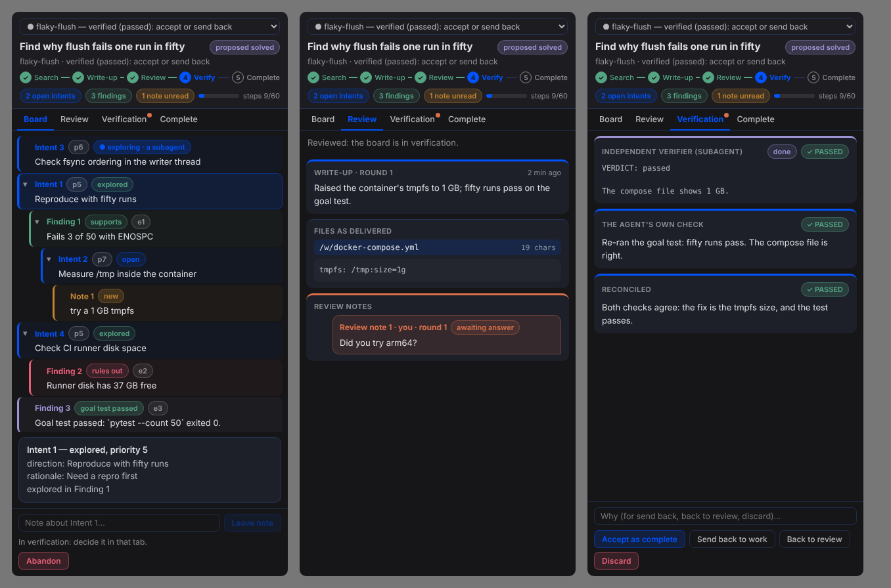

# search-board

**Search boards for Hermes Agent: for problems where you know the start, can test the end,
and don't know the path, and a workflow that takes the finished work through your review and an
independent verification before it counts as done.**

These problems include an intermittent test failure, a regression hiding among a thousand
commits, or a latency number that has to drop below a threshold. What makes them hard for an
agent isn't reasoning but bookkeeping:

- what has been tried, and what it ruled out;
- what it opened up;
- which open direction is worth taking next.

Without that, a long run re-treads explored ground, loses the frontier after a compaction,
and eventually decides it has succeeded because nothing stops it from saying so.

A board keeps that structure, and it keeps the agent honest in two ways:

1. **A finding must cite real tool output.** While a board is open, every tool result the
   agent receives is recorded and tagged with an evidence id (`e12`). A finding has to cite
   ids that exist, so it can't be something the model simply said.
2. **The model never scores its own search.** The goal test is fixed when the board opens.
   `search_board_test` runs it through Hermes's own terminal tool, under your normal approval
   rules, and the plugin writes the verdict. Nothing in the tool surface can mark a board
   solved. Where no mechanical test exists, the most the agent can reach is
   `proposed_solved`, and you decide.

Ported from the board in s0ma, a long-running agent
harness.

## What the agent gets

| Tool | What it does |
|---|---|
| `search_board_open` | Opens a board: name, origin, goal, goal test (`command`, `observation` or `judgment`) and step budget. |
| `search_board_list` | Lists boards that are live or waiting for you. |
| `search_board_read` | Shows your notes first, then the frontier (open leads by priority), then recent findings (paged). |
| `search_board_leads` | Declares directions worth trying, each with a rationale naming the findings behind it. |
| `search_board_claim` | Claims a lead before exploring it. Claims go stale after 30 minutes. |
| `search_board_finding` | Records one finding per exploration (`supports` or `rules_out`), citing evidence ids. Spends a step. |
| `search_board_rule_out` | Rules a lead out. Requires a `rules_out` finding. |
| `search_board_test` | Has the plugin run the goal test and record the verdict. Spends a step. |
| `search_board_close` | Closes as `proposed_solved`, `proposed_exhausted` (only with an empty frontier) or `abandoned`. |
| `search_board_report` | Writes up a finished board, with the files that make up the work (kept as delivered). |
| `search_board_answer` | Answers one of your review notes. Every note needs an answer before the next write-up. |
| `search_board_review` | Reads the write-up and the files as delivered. |
| `search_board_verify` | Files the agent's own check of a board in verification. |
| `search_board_verification` | Reconciles its own check with the independent verifier's into the report you accept or send back. |

It also gets:

- **A bundled skill**, `search-board:search-board`, with the search loop.
- **A short block on every turn**, with one line per board, so a search stays visible after
  a compaction. The block is injected into that turn only, never persisted, and absent when
  there are no boards.

**Subagents** can work a board the main agent opened. A subagent can't open or close boards,
holds one claim at a time, must name the lead its finding explores, and can't rule out a
lead someone else is exploring. Its reads leave your notes marked new for the main agent.

When the step budget runs out, the board suspends. The graph stays intact and you decide
whether to extend it.

## The workflow: from finished to complete

```text
working ──agent: report──▶ review ──you: back──▶ working (a new round)
                             │ └──you: verify──▶ verification ──you: accept──▶ complete
                             │                        └──you: back / toreview──▶ …
                             └──you: exhaust (a proposed_exhausted board)──▶ complete
any stage ──you: discard──▶ discarded
```

1. **Write-up.** A board that passed its goal test, or that the agent closed `proposed_solved` or
   `proposed_exhausted`, owes a write-up: what was done, how it was checked, and what is left. The
   agent names the files that make up the work. The plugin reads them through Hermes's `read_file`,
   so it works with any terminal backend, and keeps them as they were at that moment. You review
   what was delivered, not what is on disk now.
2. **Review.** You read the write-up and the files and leave review notes (Review note 1, 2…).
   - **Send it back**, and the board opens again in a new round. The agent must answer every note
     before it can write the board up again.
   - **Send it to verification** when you're satisfied.
3. **Verification.** Two checks run independently:
   - **The independent verifier** is a Hermes subagent, launched through Hermes's subagent
     lifecycle (`ctx.subagent_lifecycle`) as a leaf child of the main agent. It starts with none of
     the agent's conversation: only the board, the write-up, the delivered files, your notes with
     the answers, and every finding with the tool output it cites. It's told not to trust the
     write-up and to check each claim on the machine: it gets the terminal and file tools (within
     what the parent session has), runs the goal test, and reads and builds the delivered files.
     It can read the board but not change it. Hermes only starts subagents during an agent turn, so
     the verifier starts at the agent's next turn (at once, if you've allowed the plugin to start
     turns; see below). Its report comes back through the `subagent_stop` hook.
   - **The agent's own check** can use tools: it re-runs the test and reads the delivered files.
   - The verifier's report is **held from the agent until it has filed its own check**. Then the
     agent reconciles the two into one report, with a verdict.
4. **Complete.** You accept the reconciled report, and the board is closed solved,
   "verified (passed); accepted by the operator". Or you send it back to work, or back to review.
   From complete you can reopen it or have it verified again.

Discarding works from any stage. "Exhausted" stays your word, as before.

**Waking the agent.** Some of your moves need the agent: sending a board back, sending it to
verification, and the verifier's report once the agent may see it. If you allow it, the plugin
starts a turn in the session that last worked on the board:

```yaml
# ~/.hermes/config.yaml
plugins:
  entries:
    search-board:
      allow_gateway_injection: true
```

Without that, the agent hears with your next message, in that session or any other, and a
verifier you sent a board to starts then.

## What you get

**`/sboard`** works in every surface (CLI, TUI, Desktop, Telegram, Discord…):

```
/sboard                      boards that are live or waiting for you
/sboard show <name> [all]    the board as a tree
/sboard detail <name> <ref>  one intent, finding or note in full, e.g. "Finding 2" (with its evidence)
/sboard note <name> [Intent 3:] <text>   leave a note, optionally about an intent or finding
/sboard unnote <name> <Note 2>      take a note off
/sboard confirm|exhaust <name>      accept a proposal
/sboard reject <name> [why]  send a proposal back; your reason becomes a note
/sboard extend <name> <steps>       give a suspended board more steps
/sboard abandon <name> [why] stop a search

/sboard review <name>        the write-up, the files as delivered, your review notes and the answers
/sboard file <name> <path>   one delivered file, as delivered
/sboard comment <name> <text>      leave a review note
/sboard uncomment <name> <Review note 2>   take back a note the agent hasn't answered
/sboard back <name> [why]    send it back to work (a new round)
/sboard verify <name>        send it to verification
/sboard verification <name>  both checks and the reconciled report
/sboard reverify <name>      run a failed verifier again
/sboard accept <name>        accept it as complete
/sboard toreview <name> [why]      back to review, from verification or complete
/sboard discard <name> [why] throw it away, wherever it is
```

The board reads as the tree it was searched as: goal → leads → what each found → the leads
that opened.

```
[*] flaky-flush — Find why test_flush fails one run in fifty
│  open · steps 3/60 · frontier 1 · 3 findings · opened 12 min ago
│  goal: 50 green runs
│  test (command): pytest tests/test_flush.py --count 50
├─ [?] Intent 2 · p5 — Check fsync ordering in the writer thread
├─ [+] Intent 1 · p8 · explored — Reproduce locally with --count 50
│  └─ [+] Finding 1 · supports — Fails 3/50 locally, always ENOSPC from flush() (e1)
│     └─ [*] Intent 4 · p7 · exploring (the main agent, 2 min ago) — Measure /tmp inside the container
│        └─ [!] Note 1 · new — the container mounts /tmp as a 64 MB tmpfs
├─ [+] Intent 3 · p5 · explored — Check CI runner disk space
│  └─ [-] Finding 2 · rules out — Runner disk has 37 GB free (e2)
└─ [-] Finding 3 · goal test · failed — Goal test failed (exit 1): `pytest tests/test_flush.py --count 50`. (e3)
```

The markers mean:

- `[+]` done, or supports;
- `[*]` under way;
- `[-]` ruled out or failed;
- `[?]` open;
- `[!]` wants you (a proposal, a suspended board, or a note the agent hasn't read).

**The Desktop pane** ("search boards") shows the same tree live, with folding, color-coded by
kind (blue intents, green and red findings, yellow notes) and a stepper across the top:
Search → Write-up → Review → Verify → Complete. Its four tabs, Board, Review, Verification and
Complete, are there from the start; a tab that waits on you gets a dot.


 The workflow tabs show the write-up, the files as delivered, your notes with the agent's answers,
both checks and the reconciled report, with every workflow move as a button. Click a row for
its full text; a finding also shows the tool output it cites. Below that you can leave a note
about the selected lead or finding, take a note off, confirm or send back a proposal, extend
a suspended board, or abandon one. Confirming and abandoning take a second click.

The agent hears about your decisions with its next turn.

## Install

```bash
hermes plugins install search-board --enable              # once listed in the catalog
hermes plugins install t4lus/search-board --enable        # straight from GitHub
```

Then, in Desktop: **Capabilities → Plugins → search-board**, and enable the desktop half to get
the pane.

## Disclosures

- **Tool results are recorded while a board is open.** While at least one board is open, the
  plugin records an excerpt of every tool result the agent receives: the first and last
  2,000 characters, the first 1,000 characters of its arguments, its length and its SHA-256.
  These go to `<hermes home>/plugin-data/search-board/boards.db`, and the plugin tags the result
  with an evidence id. With no board open, nothing is recorded or changed.
- **Retention.** Evidence that no finding cites is deleted after 14 days. Results of the
  plugin's own tools are never recorded.
- **Tagging changes tool results.** For JSON object results the tag is an added `"_evidence"`
  key; for anything else it's a final `[evidence eN]` line.
- **Goal tests run through Hermes's terminal tool.** `search_board_test` runs the board's
  goal-test command through `terminal`, in the same backend and under the same approval rules
  as any command the agent runs. The command is the one the agent declared when it opened the
  board. A refused or blocked command records nothing.
- **Delivered files.** `search_board_report` reads the files the agent names through Hermes's
  `read_file` tool (at most 30 files and 2 million characters) and keeps them in the plugin's
  database.
- **The verifier is a subagent.** Each verification launches one Hermes subagent through
  `ctx.subagent_lifecycle`, with role `leaf` and the `terminal` and `file` toolsets (narrowed to
  what the parent session allows). It runs commands and reads files under Hermes's own rules
  for child agents: the same backend, approvals and limits as any subagent. Its goal and context
  carry the board, the write-up, the delivered files, your review notes and the tool output the
  findings cite (at most 30,000 characters of context). It uses your configured model and
  credentials; the plugin never sees a token. Like any delegation, it's reported to an external
  memory provider if you use one. If the board moves on (sent back, discarded), the verifier is
  cancelled at the next turn.
- **Starting turns.** If you grant `allow_gateway_injection`, your workflow moves start a turn in
  the board's session through `ctx.inject_message`. Without it, nothing is injected.
- **A background thread.** On first use, a daemon thread starts. Every 3 seconds it reads the
  plugin's own database to deliver those turns and to notice a verifier that a restart cut
  off. It never launches anything itself. It stops when the plugin unloads.
- **Context injection.** The `pre_llm_call` hook adds a few lines (one per board, plus your
  recent decisions) to the main agent's current turn. Nothing is persisted.
- **What the plugin doesn't do.** No network calls of its own (the verifier's model calls go through Hermes), no telemetry, no credentials, no
  background processes, no shell commands of its own, and no self-updater.
- **The Desktop pane's backend.** It talks only to this plugin's own routes
  (`/api/plugins/search-board/…`). Those routes read boards, evidence and the workflow, and
  accept only your actions: notes, extend, confirm, exhaust, reject, abandon, and the workflow's
  moves. Nothing there writes a lead, a finding, a write-up or a check.

## Development

```bash
pytest                                   # store, tools, hooks, commands, routes (needs fastapi for the routes)
cd tests/desktop && npm install && \
  SEARCH_BOARD_PANE_FIXTURE=$PWD/fixture.json pytest ../.. -k fixture && npm test   # the pane, in jsdom
hermes plugins validate . --install-deps
```

The Python tests run without Hermes against a fake context. The pane test renders
`desktop/plugin.js` with React in jsdom against a snapshot the real backend routes produced.

## License

MIT
